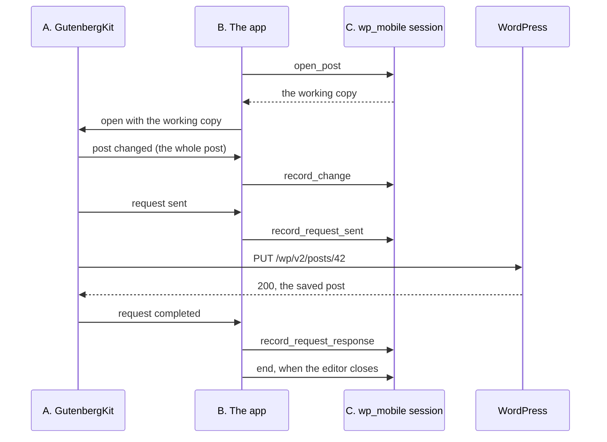

# Proposal: the editor reports to wordpress-rs

## Summary

While the editor is open, it reads and saves the post itself. When the user saves, GutenbergKit runs Gutenberg's own `savePost()`, so plugins' save hooks run.

The editor reports what it does to the app: every change to the post, and every request it sends for the post, with the response or failure that came back. The app passes each report to wordpress-rs, which records it:

1. a change becomes a new version in the history of the post's working copy;
2. a request goes into the editor session's request log, and is completed when its response or failure is reported.

Information flows one way, from the editor to wordpress-rs. The exception is opening the editor, when wordpress-rs gives it the working copy. Reports never wait for wordpress-rs: the editor sends its request whatever happens to the report.

Once the editor closes, wordpress-rs is the only one that pushes the post. An app that doesn't ask GutenbergKit for reports gets GutenbergKit's built-in behavior, unchanged.

## Why

**GutenbergKit needs the editor to run the save.** Plugins can run code when a post is saved, through hooks on Gutenberg's [`savePost()`](https://github.com/WordPress/gutenberg/blob/%40wordpress/editor%4016.1.0/packages/editor/src/store/actions.js#L243-L476). When the app saves the post itself, `savePost()` never runs, and neither do those hooks ([CMM-2024](https://linear.app/a8c/issue/CMM-2024/videopress-metadata-change-not-persisted) is one resulting bug, in VideoPress). [Editor-driven saving](https://linear.app/a8c/document/editor-driven-saving-design-5520af8f36b9) has the editor save the post to the server while it's open, and the app after it closes.

**The editor makes its own requests.** Gutenberg is working on multi-user support, which is one of the reasons for the editor handling its requests itself. Others are working on what the editor opens with when the server and the device both have a version of the post, inside the editor. wordpress-rs stays out of both, so the two don't collide.

**wordpress-rs needs to keep what the user wrote, and what happened to it.** Local content storage ([wordpress-rs#1682](https://github.com/Automattic/wordpress-rs/pull/1682), a draft) keeps the posts the user edits on the device, so they're never lost. With the editor's reports, it also keeps every version the user went through, and every request the editor sent. After a crash, or when the system ends the app, wordpress-rs can tell from its own records what the user wrote, and which requests got an answer.

## Terms

- **Working copy**: the user's version of a post or page, stored on the device by wordpress-rs. Only the user changes it, and only an explicit user action deletes it.
- **Version**: the working copy's fields at one point. Every change to a working copy adds a version, and the newest version is the working copy's fields. The versions together are its **history**.
- **Parent**: the version a version was made from. Editing from an older version makes a new version whose parent is that older one.
- **Cache**: wordpress-rs's copy of what it last learned the server has. It's a separate database from the working copies.
- **Editor session**: one stretch of editing a post, from opening the editor to closing it. wordpress-rs records each session in its database.
- **Request log**: the requests the editor reported during a session, each with the response or failure that came back.
- **Push**: sending a working copy to the server. Only wordpress-rs pushes, and only once the editor has closed.
- **Base version**: the server's `modified_gmt` for the version of the post a working copy's changes start from.
- **Source of truth**: while the editor is open, the editor is the source of truth. The working copy follows it a moment behind, as reports arrive. Once the editor closes, the working copy is the source of truth.
- **Editor protocol**: what GutenbergKit offers the app: the reports, opening with a post, and saving. GutenbergKit defines it.
- **Session protocol**: what wordpress-rs offers the app: editor sessions that record the reports. wordpress-rs defines it.

## The layers

| | Layer | Defines | Depends on |
| -- | -- | -- | -- |
| A | GutenbergKit, the editor library | The editor protocol | Nothing from wordpress-rs. |
| B | The app: GutenbergKit's example app first, then WordPress-iOS and WordPress-Android | Nothing | Both protocols. It's the only layer that knows both. |
| C | `wp_mobile`, wordpress-rs's business layer | The session protocol | Layer D. |
| D | `wp_mobile_local_content`, in wordpress-rs | Storage for working copies, their history, and editor sessions | Nothing from GutenbergKit. |

The two protocols are decoupled. They may look alike, but each follows its own library's conventions, and either can change without the other. The app converts between them.



## How to read the pseudocode

Names are placeholders. Two markers:

- `[decision]`: a choice made in exactly one place, which can change without touching the other layers.
- `[not designed]`: a path nobody has designed yet. The pseudocode shows where it plugs in.

## A. The editor protocol

GutenbergKit gains these things the app can use:

1. **An opt-in.** The app passes a listener before the editor loads. With it, the editor saves the post itself and reports what it does. Without it, nothing changes.
2. **Change reports.** Whenever anything in the post changes, the editor reports the whole post: the content, settings such as the categories, and plugins' fields. It reports whether or not the user saves, a moment after the edits stop changing, so typing sends one report rather than one per keystroke.
3. **Request reports.** For each request for the post, the editor reports it when it's sent, and again with its response or its failure. The request has an ID, so the app can pair the reports.
4. **Saving.** The app can ask the editor to save, which runs `savePost()` as the editor's own save button would.
5. **Opening with a post.** The app passes in the post the editor opens with.

The interface, sketched in Kotlin. The Swift version would mirror it.

```kotlin
interface EditorPostActivityListener {
    /** The post changed. `post` is the whole post, in the REST API's edit shape. */
    fun onPostChanged(post: ByteArray)                    // JSON

    /** The editor sent a request for the post. */
    fun onPostRequestSent(request: EditorPostRequest)

    /** A request the editor reported sending got a response, with any status. */
    fun onPostRequestCompleted(response: EditorPostResponse)

    /** A request the editor reported sending got no response, such as offline. */
    fun onPostRequestFailed(requestId: String, reason: String)
}

data class EditorPostRequest(
    val requestId: String,               // unique while the editor is open
    val method: String,
    val path: String,                    // e.g. /wp/v2/posts/42?context=edit
    val headers: Map<String, String>,    // never the site credential
    val body: ByteArray?,
)

data class EditorPostResponse(
    val requestId: String,
    val status: Int,
    val headers: Map<String, String>,
    val body: ByteArray,                 // the server's bytes, unchanged
)

// Runs Gutenberg's save. The request it sends is reported like any other.
suspend fun GutenbergView.savePost()

// Optional, like `mediaUploader` today: set it before the editor loads.
gutenbergView.postActivityListener = listener
```

How GutenbergKit builds these is up to GutenbergKit. These are the parts the session protocol relies on:

- **The post's requests** are requests for the post's path, such as `/wp/v2/posts/42`, and for the paths below it, such as its autosaves. A new post's create, a `POST` to its collection, counts too.
- **The reports never wait for the app.** The editor sends its request whether or not a report arrived. If the app's process ends between the two, the request log is missing that report. That's accepted: the next change report is a moment away, so what's missing is small.
- **Responses are the server's bytes.** wordpress-rs reads them to learn what the server has, so they mustn't be rebuilt from the editor's own types.

`[decision]` Where the editor's identity comes from. wordpress-rs records who the editor makes its requests as, in a form that isn't a credential, such as a hash of the token. On iOS, with GutenbergKit's REST relay, the editor's page doesn't hold the site credential, so the identity can't come from the page. It could come from GutenbergKit's native code, as part of the editor protocol, or from the app, which configured the editor's credential. What wordpress-rs does with it waits on the details of multi-user support.

`[not designed]` What the editor opens with, and how it reconciles it with the server's version. wordpress-rs gives the app the working copy as the latest version of the post. The editor fetches the server's version itself, and works out the rest.

## B. The app

The app implements the editor protocol's listener by calling the session protocol, and converts between the two libraries' types.

```kotlin
// Opening a post starts an editor session.
val session = postEditorService.openPost(postId = postId, editorIdentity = identity)
val editorPost = session.editorPost()      // the working copy, as the latest post
val gutenbergView = GutenbergView(configuration.withPost(editorPost), /* ... */)

gutenbergView.postActivityListener = object : EditorPostActivityListener {
    override fun onPostChanged(post: ByteArray) =
        record { session.recordChange(post) }
    override fun onPostRequestSent(request: EditorPostRequest) =
        record { session.recordRequestSent(request.toSessionRequest()) }
    override fun onPostRequestCompleted(response: EditorPostResponse) =
        record { session.recordRequestResponse(response.requestId, response.toSessionResponse()) }
    override fun onPostRequestFailed(requestId: String, reason: String) =
        record { session.recordRequestFailure(requestId, reason) }
}

// The user taps Save.
scope.launch { gutenbergView.savePost() }

// Closing the editor ends the session.
override fun onEditorClosed() = session.end()
```

`record` passes the reports on in the order they arrived, so a response never reaches the session before its request.

## C. The session protocol

`wp_mobile` already has [`LocalContentService`](https://github.com/Automattic/wordpress-rs/blob/e6d2a8d85d06427d31a2b4f9e2468c4811c037be/wp_mobile/src/service/local_content.rs#L15-L35), which stores working copies and never talks to the server. The proposal adds `PostEditorService` beside it. Opening a post returns a `PostEditorSession`, which records the editor's reports.

```rust
impl PostEditorService {
    /// Start an editor session for a post from the server. Uses the post's
    /// working copy if it has one, otherwise creates one from the post in the
    /// cache, fetching it if needed. `editor_identity` is recorded on the
    /// session as given.
    pub async fn open_post(&self, post_id: PostId, editor_identity: Option<String>) -> Result<PostEditorSession>;

    /// Start an editor session for a new post: a working copy with no remote post.
    pub fn open_new_post(&self, editor_identity: Option<String>) -> Result<PostEditorSession>;

    /// The sessions that didn't end normally, such as when the app crashed.
    pub fn read_unfinished_sessions(&self) -> Result<Vec<EditorSession>>;
}

impl PostEditorSession {
    /// What the editor opens with: the working copy, as the latest version of
    /// the post, and the post's server ID if it has one.
    pub fn editor_post(&self) -> Result<EditorPost>;

    /// The post changed: the whole post becomes a new version of the working
    /// copy, recorded in this session.
    pub async fn record_change(&self, post: Json) -> Result<()>;

    /// The editor sent a request: it goes into the request log.
    pub async fn record_request_sent(&self, request: EditorRequest) -> Result<()> {
        self.log.record_sent(&request)?;
        // [decision] A request that writes the post holds exactly what the
        // editor is sending, so it's also recorded as a version. Change
        // reports can be a moment behind it.
        if request.writes_the_post() {
            self.record_fields(request.body)?;
        }
        Ok(())
    }

    /// A request got a response: the log entry is completed with it.
    pub async fn record_request_response(&self, request_id: String, response: EditorResponse) -> Result<()> {
        let request = self.log.record_response(&request_id, &response)?;
        // Only a successful response holding the session's whole post: a
        // read without `_fields`, a create, or an update.
        let Some(post) = whole_post(&request, &response) else { return Ok(()) };

        // [decision] The response updates the cache, through the same path
        // wordpress-rs's own responses take, unless the cache already has a
        // newer version. The response stays in the log either way.
        if !self.cache.has_newer(&post) {
            self.cache.upsert_post(&post)?;
        }
        // [decision] A successful write means the server has what the editor
        // sent, so its response becomes the base version. A create links the
        // working copy to the new post.
        if request.writes_the_post() {
            self.local_content.record_post_working_copy_push(self.working_copy_id, RemotePostReference::from(&post))?;
        }
        Ok(())
    }

    /// A request got no response: the log entry is completed with the reason.
    pub async fn record_request_failure(&self, request_id: String, reason: String) -> Result<()>;

    /// End the session normally, when the editor closes.
    pub fn end(&self) -> Result<()>;
}
```

A session records one report at a time, in the order they arrive, so the history and the request log follow the editor's order.

## D. Storage

What exists, in [wordpress-rs#1682](https://github.com/Automattic/wordpress-rs/pull/1682): the [working copy types](https://github.com/Automattic/wordpress-rs/blob/e6d2a8d85d06427d31a2b4f9e2468c4811c037be/wp_mobile_local_content/src/db_types/working_copy.rs#L132) and their database. The proposal changes how a working copy is stored, and adds editor sessions.

**A working copy is an ID with a history.** Its fields live in its versions, and the newest version holds its fields. Saving a working copy adds a version, made from the newest one. Saving the fields it already has adds nothing.

To keep the history small, the content is stored apart from the other fields. A version refers to one content row and one row of the other fields. When only the title changes, the new version reuses its parent's content row. When only the content changes, it reuses its parent's other fields.

```rust
pub struct WorkingCopyVersion {
    pub id: WorkingCopyVersionId,
    /// `None` for the working copy's first version.
    pub parent: Option<WorkingCopyVersionId>,
    /// `None` when the version was saved outside an editor session.
    pub editor_session_id: Option<EditorSessionId>,
    pub created_at: String,
}

pub fn read_working_copy_versions(&self, id: WorkingCopyId) -> Result<Vec<WorkingCopyVersion>>;
pub fn read_post_working_copy_version(&self, id: WorkingCopyVersionId) -> Result<Option<PostWorkingCopyFields>>;
```

`[not designed]` Thinning the history. It removes the oldest versions first, when the history goes over a total size or past an age. Both limits are settings the user can change. Removing a version means giving its children another parent first. The newest version is never removed, since it's the user's current content.

`[not designed]` Using the history, such as going back to an older version and editing from it.

**Fields a working copy doesn't model.** Plugins can add their own fields to a post, as post meta or as top-level fields of their own. The working copy stores both as JSON, as the cache does, and pushes them as they are. wordpress-rs can say which key changed, but not what its value means.

**Editor sessions.** One record per session, stored with the working copies, so clearing the cache never removes it.

```rust
pub struct EditorSession {
    pub id: EditorSessionId,
    pub working_copy_id: WorkingCopyId,
    /// Who the editor makes its requests as, recorded as given. Nothing uses
    /// it yet.
    pub editor_identity: Option<String>,
    pub started_at: WpGmtDateTime,
    /// When a change was last recorded.
    pub last_recorded_at: Option<WpGmtDateTime>,
    /// Set when the session ends normally. A session without it didn't.
    pub ended_at: Option<WpGmtDateTime>,
}

pub struct EditorRequestRecord {
    pub request: EditorRequest,
    pub sent_at: WpGmtDateTime,
    /// `None` when no response or failure was recorded for it.
    pub outcome: Option<EditorRequestOutcome>,   // Response { .. } or Failure { .. }
}
```

The request log never stores a credential. Headers that carry one, such as `authorization` and `cookie`, are left out of every stored request and response.

## The other paths

### New posts

Opening a new post creates its working copy and its editor session straight away. The editor creates the post on the server when it first saves it. The reported create links the working copy to the new post, so the working copy and the server agree on its ID.

`[not designed]` How the editor moves to the new post's ID. Inside Gutenberg, the post's ID is the key it stores the post under, so it has to move the post to the new key with its unsaved edits. Editor-driven saving plans this as `adoptPost` ([CMM-2564](https://linear.app/a8c/issue/CMM-2564/let-the-host-hand-a-newly-created-post-id-to-the-editor)), and clearing the undo history with it ([CMM-2742](https://linear.app/a8c/issue/CMM-2742/clear-the-undo-history-when-the-editor-adopts-a-new-post-id)).

### A session that didn't end normally

A session that ends normally records when it ended. One that doesn't, because the app crashed or the system ended it in the background, is still unfinished the next time the app runs. Everything it recorded is still there: the working copy's versions up to `last_recorded_at`, and the request log. A request with no outcome is one whose response nobody recorded.

`[decision]` What the app does with an unfinished session: reopen the editor, offer to, or leave the working copy for the post list.

### Pushing after the editor closes

`[not designed]` When and how wordpress-rs pushes a working copy that has changes the server doesn't have, including after a session that didn't end normally. It's the one push path. While the editor is open, wordpress-rs doesn't push.

Plugins' save hooks don't run for pushes made after the editor closes, because the editor isn't involved.

### Autosaves, previews and revisions

The editor makes these requests itself. They're below the post's path, so they're reported and logged like any other request for the post. A response from them isn't the post, so it doesn't update the cache.

## The proof of concept

The proof of concept is on the `editor-reports` branches of wordpress-rs and GutenbergKit.

- wordpress-rs builds layers C and D for posts: the session protocol, the history, and the request log. Pushing after the editor closes is a placeholder: it fetches the post first, sends only the fields that changed, and refuses when the server and the working copy both changed.
- GutenbergKit has stand-ins for the editor protocol, in JavaScript and in the iOS library, for the example app to use until GutenbergKit builds it. The iOS example app opens posts in an editor session.

It leaves out:

- **Pages and custom post types.** `PostEditorService` handles `/wp/v2/posts` only.
- **Android.** Neither the library's stand-in nor the example app.
- **New posts in the example app**, until the editor can move to a new post's ID.
- **The iOS example app isn't compiled yet.** It needs a wordpress-rs build with the session protocol.

## Verified

Against the test server, in wordpress-rs's integration tests:

- A save the editor sends and reports leaves the working copy's base version at the `modified_gmt` the server has afterwards.
- A create the editor sends and reports links the working copy to the new post.
- An update response holds the whole post in the edit context, for updates sending only the title, only the status, or no fields.

In unit tests, against a scripted server: the cache isn't updated by a response that's older than the cached post, holds only some fields, has an error status, or is for another post; and credential headers aren't stored.

Not tried yet: the editor protocol's stand-ins in a running editor, end to end.
